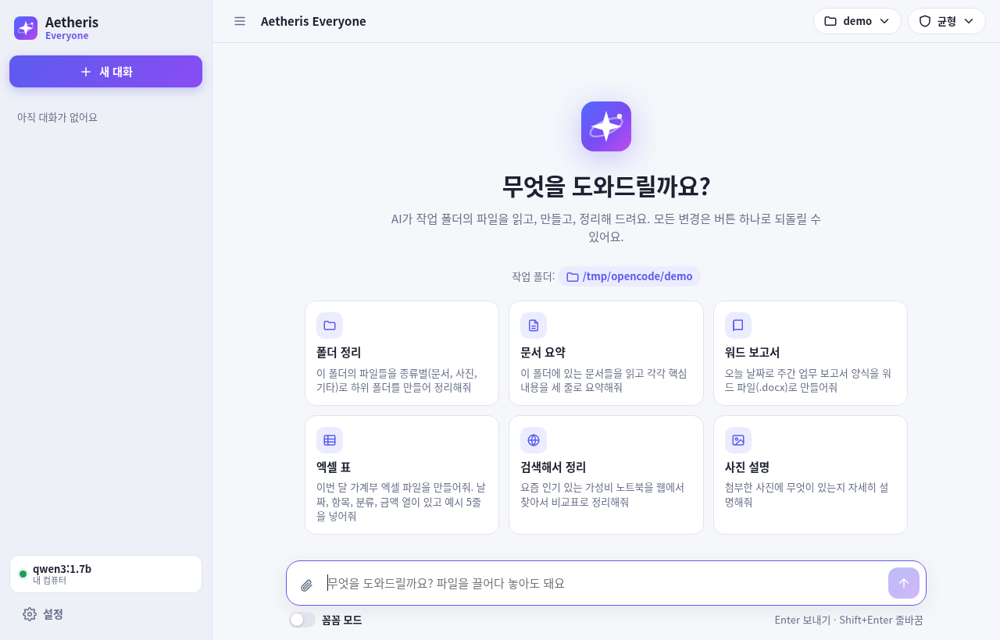
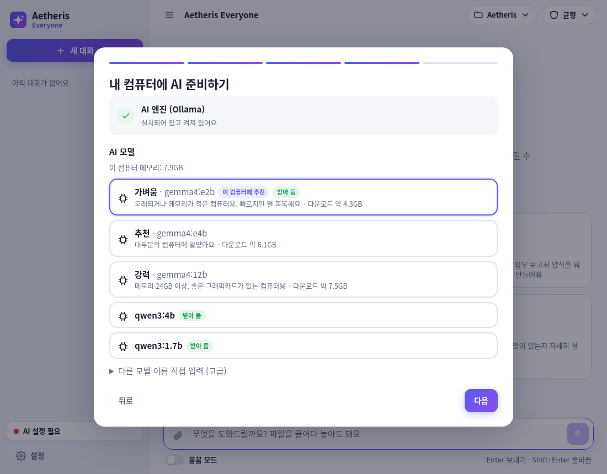

<p align="center">
  
</p>

<h1 align="center">Aetheris Everyone</h1>

<p align="center">
  <b>An AI assistant that organises the files on your computer and writes documents for you — just ask in plain words</b><br>
  No terminal · one double-click · every change undoable with one button
</p>

<p align="center">
  <a href="https://github.com/minjun1177/aetheris-everyone/releases/latest"><b>⬇ Download (Windows · Mac · Linux)</b></a>
  &nbsp;·&nbsp; <a href="README.ko.md">한국어</a>
</p>

<p align="center">
  
</p>

**Aetheris Everyone** is [Aetheris](https://github.com/minjun1177/aetheris) — a terminal AI assistant for developers — rebuilt as a desktop app for **people who have never opened a terminal**. You chat with it, and the AI works directly **inside the folder you chose**: it reads, writes, moves and deletes files, asks before anything risky, and records every change so one click takes it back.

```text
 window (HTML/JS)  ──token──▶  local server 127.0.0.1  ──▶  agent loop  ──▶  AI model
                                                         │                (Ollama / Claude /
                                                         ▼                 ChatGPT / Gemini)
                                     tools ── safety checks ── permission card
                                       │
                                       └── change history (undo, conflict check)
```

---

## What it does

| Say this | The AI does |
| :--- | :--- |
| "Move the photos in this folder into a 'Photos' folder" | Creates the folder and moves the files |
| "Read the meeting notes and tell me only the decisions" | Reads Word · Excel · PowerPoint · PDF · Hangul (HWPX) and summarises |
| "Make a weekly report template as a Word file" | Creates a real `.docx` file |
| "Make a household budget spreadsheet for this month" | Creates a real `.xlsx` file |
| "Make a 4-slide deck on spring health tips" | Creates a real `.pptx` file |
| "Move only the receipt photos into a 'Receipts' folder" | Looks at each picture itself, then sorts them |
| "Find good-value laptops and put them in a table" | Web search → read pages (and PDFs on the web) → summarise |
| "Remember that I like reports with a summary first" | Remembers it for later chats, after asking (**Settings → Memory**) |
| (drop a photo) "Describe this picture" | Looks at the picture (with models that can see) |
| "Solve $x^2-5x+6=0$" | Formulas in replies are typeset (LaTeX via KaTeX) |

### Safe to use

- **It asks before changing things** — three safety levels (Always ask / Balanced / Do everything).
  - **Balanced (default):** work inside the work folder happens right away; anything outside it is asked first.
  - **Do everything:** still asks before **changing anything outside the work folder** and before **running a program**.
- **Running programs is off by default.** It can be turned on in **Settings → General**; even then every command is shown and asked first, at every safety level — "Allow for this chat" is never offered for a program.
- **Allowing a look outside the work folder is not allowing changes there** — "Allow for this chat" on a read outside the folder still asks before anything there is changed.
- **Every change can be undone** — every file the AI creates, edits, moves or deletes is listed in a card under the reply, and **[Undo this]** puts it all back. Deleting never really deletes: the file is kept aside. If you edited a file yourself in the meantime, or added files to a folder the AI copied, it tells you before overwriting — and a forced undo keeps your own files.
- **It can run entirely on your computer** — with the free local AI (Ollama), chats and files never leave your machine.

<p align="center">
  
</p>

---

## Installation / Usage

### Option A — Download the app (no terminal)

1. Get the file for your computer from the [**Releases page**](https://github.com/minjun1177/aetheris-everyone/releases/latest).

   | Your computer | File |
   | :--- | :--- |
   | **Windows 10 / 11** | `AetherisEveryone-Windows.exe` |
   | **Mac (M1–M4)** | `AetherisEveryone-macOS-AppleSilicon.dmg` |
   | **Mac (Intel)** | `AetherisEveryone-macOS-Intel.dmg` |
   | **Linux** | `AetherisEveryone-Linux-x86_64.tar.gz` |

2. **Double-click** it.
   - **Windows:** if "Windows protected your PC" appears, click **More info → Run anyway**. (It is a free app without a code-signing certificate.)
   - **Mac:** open the dmg and drag the app into **Applications**. If it is blocked the first time, go to **System Settings → Privacy & Security → Open Anyway**.
   - **Linux:** unpack it and double-click `AetherisEveryone`. **Settings → About** can add a desktop shortcut.

3. On first start a **setup guide** walks you through everything on screen.

<p align="center">
  
  
</p>

   - **Run on my computer (free):** if the AI engine (Ollama) is missing, **[Install automatically]** downloads its official installer, **checks it against the checksum published with the release**, and runs it; if it is off, the app starts it. It then recommends a model for your computer's memory (`gemma4:e2b` / `gemma4:e4b` / `gemma4:12b`) and **[Get]** downloads it with a progress bar. Ollama on **another computer** can be used too (see Configuration).
   - **Cloud AI:** pick Gemini (free tier) · Claude · ChatGPT, then **[Open key page]** → paste the key → **[Check connection]**.
   - Finally choose the **folder** the AI works in.

### Option B — Run from source

```bash
# 1. Get the code
git clone https://github.com/minjun1177/aetheris-everyone && cd aetheris-everyone
# 2. Install the dependencies (pywebview, ddgs, pypdf, certifi, keyring)
pip install -r requirements.txt
# 3. Start the app in a window
python -m aetheris_everyone
# 4. Run the tests (no network or Ollama needed)
python -m unittest discover -s tests
# 5. Build the double-click app
pip install pyinstaller pillow && pyinstaller packaging/aetheris_everyone.spec
```

Pushing a `v*` tag makes GitHub Actions build the Windows · macOS · Linux apps, start each built app in a smoke test, and publish them on Releases.

### Using it

<p align="center">
  
</p>

- Type a request and press **Enter**. Attach files and pictures by **dragging them onto the window** or with the 📎 button.
- What the AI is doing appears live as **activity cards** (reading a file, searching the web …). Click a card for details.
- When permission is needed a yellow **permission card** appears, with what and why and a preview of the change: **[Allow] [Allow for this chat] [Deny]**.
- The green card under a reply lets you **open / show in folder / undo** each changed file.
- **Careful mode** makes it work as "plan → do → check".
- The **model button** next to Send switches between the models of every connected AI in one click; under the box you see **how many tokens** this chat used and, for a local model, how full its memory is.
- **Select text** in any message to **reply to that part**, ask for **a simple explanation**, or copy it.
- Hover the last request to **edit and resend** it or **retry**; an error card has **Try again**. Files stay as they are, and their Undo cards are kept.
- The **wand button** holds **saved requests** you use often.
- Long chats are **summarised** instead of silently forgetting their start.
- When the window is not in front, a **notification** says the AI finished or is waiting for permission.
- The ⬇ button next to the chat title **saves the chat as a Markdown file** in its work folder.
- A large phone photo is shrunk to a copy the AI can see; the original is kept as it is.
- When the AI service is busy (rate limit) or briefly down, it **asks again by itself** (up to three times) before showing an error.
- The 📁 button at the top changes **this chat's** work folder and holds **rules for that folder** ("file names start with the date"); the 🛡 button changes the safety level. Chats are kept on the left, with a **search box**, and the AI gives new chats a short title.
- **Settings** open in place of the chat: General, AI connection, Memory, Saved requests, **Scheduled tasks** (run a request daily, weekly or once while the app is open), **Usage** (tokens per model per month) and **Storage** (how long undo copies are kept).
- Korean / English, light / dark themes.

---

## Configuration / Environment Variables

Everything below is set in **Settings** in the app; the environment variables are for advanced use and tests.

| Setting | Default | Description |
| :--- | :--- | :--- |
| Safety level | `balanced` | `ask` · `balanced` · `auto`. `auto` still asks for changes outside the work folder and for every program run. |
| Allow running programs | off | Lets the AI use `run_command`. When off, the model is not even told the tool exists. |
| Ollama address | `http://127.0.0.1:11434` | Use Ollama on another computer, e.g. `http://192.168.0.2:11434` (that computer must allow outside connections, `OLLAMA_HOST=0.0.0.0`). Chats and file contents are then sent to that computer. |
| Web search engine | `auto` | `auto` = DuckDuckGo / Bing (via `ddgs`). `searxng` = **your own SearXNG** only; queries go nowhere else. |
| SearXNG address | — | e.g. `http://192.168.0.10:8080`. The instance must list `json` under `search: formats:` in its `settings.yml`. Checked with **[Check connection]** before it is saved. |
| Memory length | `16384` | Ollama context size (`num_ctx`). |
| Keep undo copies for | `90` days | **Settings → Storage**. `0` = never clear. Older actions can no longer be undone. |
| Notify me when it is done | on | A system notification when a turn ends or asks for permission while the window is not in front. |
| Let the AI name chats | on | A short title from the model after a new chat's first answer. |
| Remember things about me | on | **Settings → Memory**. The AI may save short facts (your name, how you like documents) for later chats, asking each time. Saved facts are listed there and can be deleted. |

---

| Variable | Default | Description |
| :--- | :--- | :--- |
| `AETHERIS_EVERYONE_HOME` | per-user app folder | Where settings, chats and undo history are kept (tests use a temporary folder). |
| `AETHERIS_OLLAMA_HOST` | — | Overrides the Ollama address setting. |
| `AETHERIS_EVERYONE_KEYRING` | — | `off` = keep API keys in the owner-only file instead of the system password store. |
| `ANTHROPIC_API_KEY` · `OPENAI_API_KEY` · `GEMINI_API_KEY` · `GOOGLE_API_KEY` | — | Used when no key is saved in the app. Never passed to programs the AI runs. |

---

### Safety and privacy

- The app is a small server that only listens on **this computer (127.0.0.1)**, plus its window. A secret token that changes every start and a Host check stop other computers and other websites from driving it.
- **API keys** are stored in the **system password store** (Windows Credential Manager, macOS Keychain, Secret Service on Linux) and never sent back to the window. Only where no such store works do they fall back to an owner-only file in the app's data folder (Settings → About shows which).
- **The AI is kept from reading the app's own settings, keys and history by itself:** the file tools refuse that folder, and commands that name it (or the password store) are refused. This is a guard against the obvious, **not a sandbox** — a program that is allowed to run can still find its way there — which is why running programs is off by default and every command is shown to you first.
- **Text the AI reads is treated as data, not orders.** The AI is told never to follow instructions found inside files, web pages or command output. A cleverly written page can still mislead a model, so read permission cards before allowing them.
- Web page reading only opens **public internet addresses** (this computer and the local network, such as your router, are blocked). The address is checked once and the connection goes to exactly that checked address, so a name that changes its answer cannot slip through. Downloads are capped, including compressed ones. The SearXNG address you enter yourself is the only local address the app will contact for search.
- With a cloud AI, your chat and the file contents the AI reads are sent to that company. The first-run guide explains this and asks for your agreement.

---

## Project Structure

```text
aetheris-everyone/
├── aetheris_everyone/
│   ├── launcher.py      opens the window (pywebview → Edge/Chrome app window → browser); single instance
│   ├── server.py        127.0.0.1-only HTTP + live events (SSE); token and Host checks
│   ├── agent.py         one turn: stream → tool calls → permission → results → repeat
│   ├── toolcalls.py     repairs broken tool calls from small models (from Aetheris)
│   ├── tools.py         16 tools and their safety checks (paths, safety level, undo record)
│   ├── memory.py        what the AI remembers between chats (asked first, listed in Settings)
│   ├── folder_rules.py  standing rules the person sets for a work folder
│   ├── saved_requests.py  requests saved to reuse with one click
│   ├── schedules.py     requests that run by themselves (once, daily, weekly)
│   ├── usage.py         tokens used per model, month by month
│   ├── history.py       undo without git: originals kept aside, conflict detection
│   ├── providers.py     Ollama · Claude · ChatGPT · Gemini (urllib only)
│   ├── ollama_setup.py  find / start / install Ollama (checksum-verified), model download progress
│   ├── documents.py     read docx/xlsx/pptx/hwpx/pdf, write docx/xlsx/pptx
│   ├── websearch.py     web search (ddgs, DuckDuckGo, Bing or SearXNG), page and PDF text; blocks the local network
│   ├── settings.py      settings, and API keys in the system password store
│   ├── prompts.py       what the model is told
│   └── web/             the window (HTML/CSS/JS, no build step)
│       └── vendor/katex/  KaTeX 0.19.1 for formulas (MIT)
├── tests/               unittest suite, no network or Ollama needed
├── packaging/           PyInstaller recipe, icons, smoke test, release notes
├── docs/images/         screenshots
├── README.md            this file
└── README.ko.md         Korean version
```

---

## Compatibility / Permissions / License

| | |
| :--- | :--- |
| **Operating systems** | Windows 10 / 11, macOS (Apple Silicon and Intel), Linux x86_64 |
| **Python (from source)** | 3.10 or newer |
| **AI services** | Ollama (local or on your network), Anthropic Claude, OpenAI ChatGPT, Google Gemini |
| **What the AI may touch** | The chosen work folder freely (per safety level); elsewhere only with permission; never the app's own data folder through its tools |
| **Network** | The chosen AI service; public web pages and search engines when asked; your SearXNG if configured |
| **License** | Apache-2.0 · bundled KaTeX under MIT (`aetheris_everyone/web/vendor/katex/LICENSE`) |

### How it differs from Aetheris

| | Aetheris (original) | **Aetheris Everyone** |
| :--- | :--- | :--- |
| For | Developers | **Everyone** |
| Interface | Terminal (`/commands`) | **Window, buttons, drag and drop** |
| Setup | `pip install`, `ollama pull` | **Double-click** · the app installs/starts Ollama and downloads models |
| Undo | git commits (`/undo`) | **Its own change history, no git** · one button · conflict detection |
| Permission | Terminal y/n | **Permission cards with a preview**, three safety levels |
| Documents | Mostly code | **Creates Word · Excel · PowerPoint**, reads PDF · HWPX, CSV that opens correctly in Korean Excel |
| Carried over | | Tool-call repair engine for small local models, native and text tool protocols, repeated-call and refusal detection, Ollama · Anthropic · OpenAI · Gemini connections, retrying a busy service, memory between chats, saving a chat as Markdown, looking at pictures, rewinding a request, summarising long chats, chat titles, scheduled requests |
