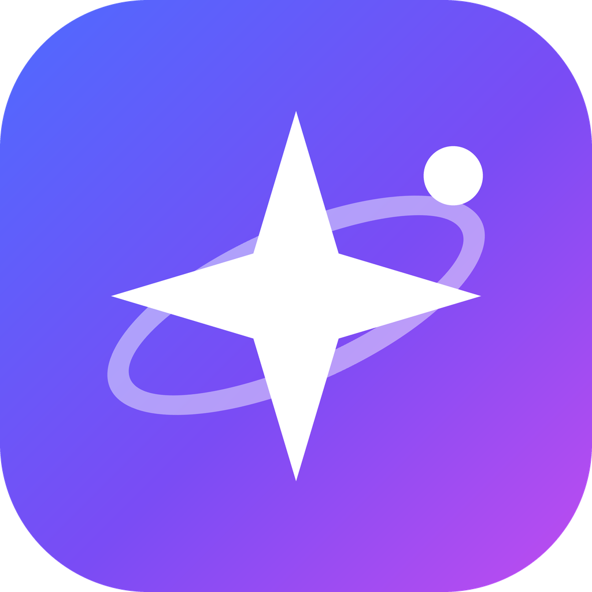
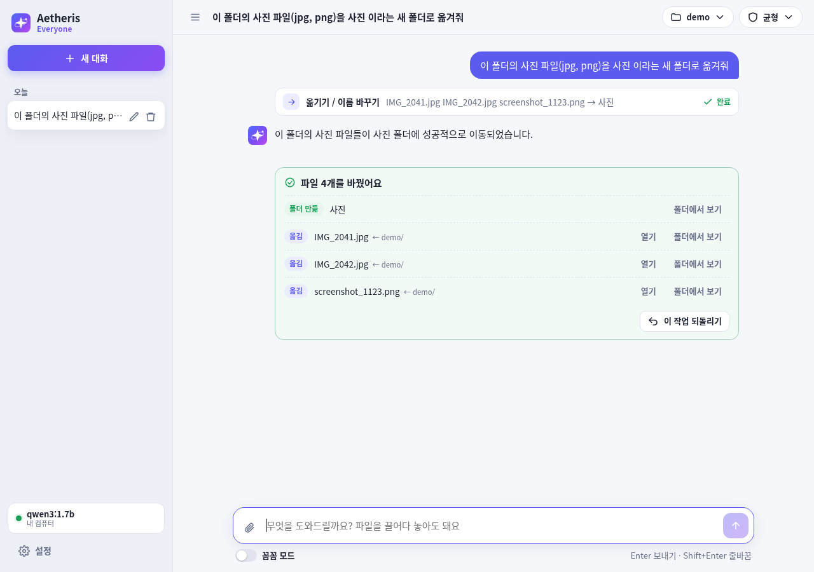
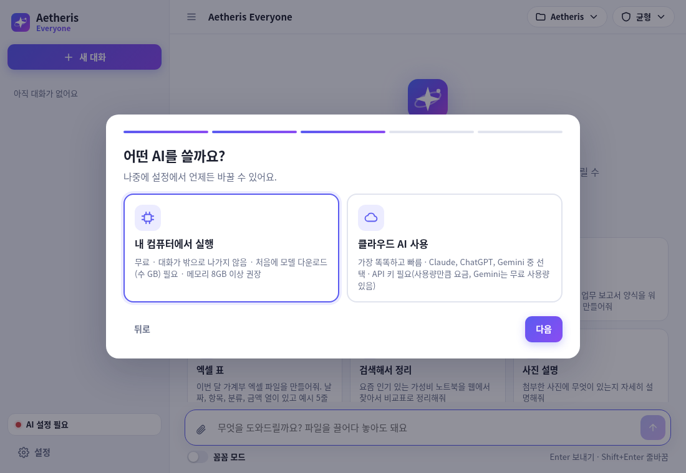
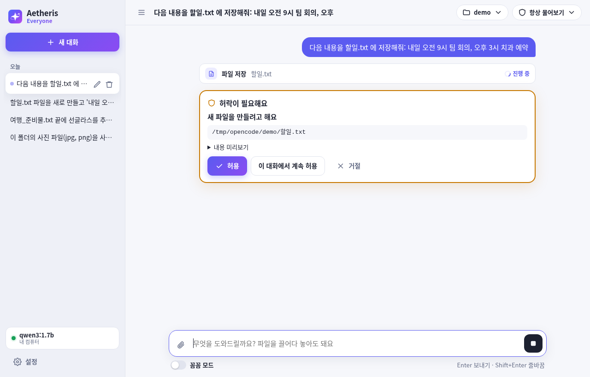

<p align="center">
  
</p>

<h1 align="center">Aetheris Everyone</h1>

<p align="center">
  <b>말로 부탁하면, 내 컴퓨터의 파일을 대신 정리하고 문서를 만들어 주는 AI 비서</b><br>
  터미널 없이 · 더블클릭 한 번으로 · 모든 변경은 버튼 하나로 되돌리기
</p>

<p align="center">
  <a href="https://github.com/minjun1177/aetheris-everyone/releases/latest"><b>⬇ 다운로드 (Windows · Mac · Linux)</b></a>
  &nbsp;·&nbsp; <a href="#english">English</a>
</p>

<p align="center">
  
</p>

---

## 어떤 프로그램인가요?

**Aetheris Everyone**은 개발자용 터미널 AI 비서 [Aetheris](https://github.com/minjun1177/aetheris)를
**개발자가 아닌 누구나** 쓸 수 있도록 창(GUI) 프로그램으로 다시 만든 것입니다.

채팅하듯 부탁하면 AI가 **내가 고른 폴더 안에서** 직접 일합니다.

| 이렇게 말하면 | AI가 하는 일 |
| :--- | :--- |
| "이 폴더 사진들을 '사진' 폴더로 정리해줘" | 폴더를 만들고 파일을 옮김 |
| "회의록 읽고 결정 사항만 알려줘" | Word·Excel·PowerPoint·PDF·한글(HWPX) 문서를 읽고 요약 |
| "주간 보고서 양식을 워드 파일로 만들어줘" | 진짜 `.docx` 파일 생성 |
| "이번 달 가계부 엑셀 만들어줘" | 진짜 `.xlsx` 파일 생성 |
| "요즘 가성비 노트북 찾아서 표로 정리해줘" | 웹 검색 → 페이지 읽기 → 정리 |
| (사진을 끌어다 놓고) "이 사진 설명해줘" | 사진을 보고 설명 (사진을 볼 수 있는 모델에서) |

### 안심하고 쓸 수 있게

- **바꾸기 전에 물어봐요** — 안전 모드 3단계(항상 물어보기 / 균형 / 모두 자동). 프로그램 실행이나 작업 폴더 밖의 일은 기본으로 항상 허락을 받습니다.
- **모든 변경은 되돌릴 수 있어요** — AI가 만들고·고치고·옮기고·지운 파일은 답변 아래 카드에 모두 표시되고, **[이 작업 되돌리기]** 한 번이면 원래대로 돌아갑니다. 삭제도 실제로 지우지 않고 보관해 둡니다. 그 사이에 내가 직접 고친 파일이 있으면 덮어쓰기 전에 알려줍니다.
- **내 컴퓨터에서만 돌릴 수 있어요** — 무료 로컬 AI(Ollama)를 고르면 대화와 파일이 컴퓨터 밖으로 나가지 않습니다.

<p align="center">
  
</p>

---

## 설치 (터미널 필요 없음)

1. [**Releases 페이지**](https://github.com/minjun1177/aetheris-everyone/releases/latest)에서 내 컴퓨터에 맞는 파일을 받습니다.

   | 내 컴퓨터 | 받을 파일 |
   | :--- | :--- |
   | Windows 10 / 11 | `AetherisEveryone-Windows.exe` |
   | Mac (M1~M4) | `AetherisEveryone-macOS-AppleSilicon.dmg` |
   | Mac (Intel) | `AetherisEveryone-macOS-Intel.dmg` |
   | Linux | `AetherisEveryone-Linux-x86_64.tar.gz` |

2. **더블클릭**해서 실행합니다.
   - Windows에서 "Windows의 PC 보호" 창이 뜨면 **추가 정보 → 실행**을 누르세요. (코드 서명 인증서가 없는 무료 앱이라 나오는 안내입니다.)
   - Mac은 dmg를 열고 앱을 **응용 프로그램** 폴더로 끌어다 놓으세요. 처음 열 때 막히면 **시스템 설정 → 개인정보 보호 및 보안 → 그래도 열기**를 누르세요.
   - Linux는 압축을 풀고 `AetherisEveryone`을 더블클릭하세요. **설정 → 정보**에서 바탕화면 바로가기를 만들 수 있습니다.

3. 처음 실행하면 **설정 도우미**가 화면에서 안내합니다.

<p align="center">
  
  
</p>

   - **내 컴퓨터에서 실행 (무료)**: AI 엔진(Ollama)이 없으면 **[자동으로 설치하기]** 버튼이 설치 프로그램을 받아 실행해 주고, 꺼져 있으면 앱이 알아서 켭니다. 그다음 컴퓨터 메모리에 맞는 모델을 추천해 주고, **[받기]**를 누르면 진행 막대와 함께 내려받습니다.
   - **클라우드 AI**: Gemini(무료 사용량 있음) · Claude · ChatGPT 중 고르고, **[키 발급 페이지 열기]** → 키 붙여 넣기 → **[연결 확인]**만 하면 됩니다.
   - 마지막으로 AI가 일할 **폴더**를 고르면 끝입니다.

---

## 사용법

<p align="center">
  
</p>

- 아래 입력창에 부탁을 적고 **Enter**. 파일·사진은 창에 **끌어다 놓거나** 📎 버튼으로 첨부합니다.
- AI가 하는 일은 **작업 카드**로 실시간 표시됩니다(파일 읽기, 웹 검색 등). 카드를 누르면 자세한 내용이 보입니다.
- 허락이 필요하면 노란 **허락 카드**가 뜹니다: 무엇을 왜 하려는지, 바뀔 내용 미리보기와 함께 **[허용] [이 대화에서 계속 허용] [거절]**.
- 답변 아래 초록 카드에서 바뀐 파일을 **열기 / 폴더에서 보기 / 되돌리기** 할 수 있습니다.
- **꼼꼼 모드**를 켜면 "계획 → 실행 → 확인" 순서로 더 신중하게 일합니다.
- 위쪽 📁 버튼으로 작업 폴더를, 🛡 버튼으로 안전 모드를 바꿉니다. 왼쪽에 대화 기록이 저장됩니다.
- 한국어 / English, 밝은 / 어두운 화면을 지원합니다.

---

## Aetheris와 무엇이 다른가요?

| | Aetheris (원본) | **Aetheris Everyone** |
| :--- | :--- | :--- |
| 대상 | 개발자 | **누구나** |
| 화면 | 터미널 (`/명령어`) | **창, 버튼, 끌어다 놓기** |
| 설치 | `pip install`, `ollama pull` | **더블클릭** · Ollama 설치/실행/모델 받기를 앱이 대신 |
| 되돌리기 | git 커밋 (`/undo`) | **git 없이** 자체 변경 기록 · 버튼 하나 · 충돌 감지 |
| 허락 | 터미널 y/n | **미리보기가 있는 허락 카드**, 안전 모드 3단계 |
| 문서 | 코드 위주 | **Word·Excel 생성**, PDF·PPT·HWPX 읽기, CSV는 한글 엑셀에서 깨지지 않게 |
| 그대로 이어받은 것 | | 작은 로컬 모델용 도구 호출 복구 엔진(괄호 누락·잘못된 형식 수리), 네이티브/텍스트 두 가지 도구 프로토콜, 같은 호출 반복·연속 거절 감지, Ollama·Anthropic·OpenAI·Gemini 연결 |

## 안전과 개인정보

- 앱은 **내 컴퓨터(127.0.0.1)에서만** 열리는 작은 서버와 창으로 동작합니다. 매번 바뀌는 비밀 토큰과 Host 검사로 다른 컴퓨터나 다른 웹사이트가 조작할 수 없습니다.
- API 키는 창에 다시 보내지 않으며 본인만 읽을 수 있는 파일에 저장됩니다. AI는 앱의 설정·키·기록 폴더에 접근할 수 없습니다.
- 웹페이지 읽기는 공용 인터넷 주소만 허용합니다(내 컴퓨터·공유기 같은 내부 주소 차단).
- 클라우드 AI를 쓰면 대화와 AI가 읽은 파일 내용이 해당 회사로 전송됩니다. 처음 실행 때 이 내용을 알기 쉽게 보여주고 동의를 받습니다.

---

## 개발자용 정보

<details>
<summary>소스에서 실행 · 테스트 · 빌드</summary>

```bash
git clone https://github.com/minjun1177/aetheris-everyone && cd aetheris-everyone
pip install -r requirements.txt
python -m aetheris_everyone                  # 창으로 실행
python -m unittest discover -s tests         # 테스트 (네트워크·Ollama 불필요)
pip install pyinstaller pillow && pyinstaller packaging/aetheris_everyone.spec   # 앱 빌드
```

`v*` 태그를 올리면 GitHub Actions가 Windows·macOS·Linux 앱을 빌드하고, 빌드된 앱을 실제로 띄워 보는
스모크 테스트를 거친 뒤 Releases에 올립니다.

```text
aetheris_everyone/
├── launcher.py      창 열기 (pywebview → Edge/Chrome 앱 창 → 기본 브라우저), 중복 실행 방지
├── server.py        127.0.0.1 전용 HTTP + 실시간 이벤트(SSE), 토큰·Host 검사
├── agent.py         대화 한 턴: 스트리밍 → 도구 호출 → 허락 → 결과 → 반복
├── toolcalls.py     작은 모델의 깨진 도구 호출 복구 (Aetheris에서 이식)
├── tools.py         13가지 도구와 안전 검사 (경로, 안전 모드, 되돌리기 기록)
├── history.py       git 없이 되돌리기: 변경 전 원본 보관, 충돌 감지
├── providers.py     Ollama · Claude · ChatGPT · Gemini (urllib만 사용)
├── ollama_setup.py  Ollama 찾기/켜기/설치, 모델 받기 진행률
├── documents.py     docx/xlsx/pptx/hwpx/pdf 읽기, docx/xlsx 만들기
├── websearch.py     웹 검색과 페이지 본문 추출 (내부망 차단)
└── web/             화면 (HTML/CSS/JS, 빌드 도구 없음)
```

</details>

---

<a id="english"></a>

## English

**Aetheris Everyone** is [Aetheris](https://github.com/minjun1177/aetheris) — a terminal AI assistant for
developers — rebuilt as a desktop app for people who have never opened a terminal.

- **Download, double-click, done.** A first-run guide sets everything up on screen: it installs and starts the
  free local AI engine (Ollama) for you and downloads a model sized for your computer — or connects Gemini,
  Claude or ChatGPT with a pasted key.
- **Ask in plain words.** It organises folders, reads Word/Excel/PowerPoint/PDF/HWPX, writes real `.docx`
  and `.xlsx` files, searches and reads the web, and looks at pictures you drop in.
- **Asks before it acts, and everything is undoable.** Three safety levels; permission cards with a preview;
  every file it creates, edits, moves or deletes is listed under the reply with a one-click **Undo** (no git
  needed, and it warns before overwriting your own later edits).
- **Private if you want.** With the local engine nothing leaves your computer.

Downloads are on the [Releases page](https://github.com/minjun1177/aetheris-everyone/releases/latest).
Korean and English UI, light and dark themes. Licensed under Apache-2.0.
